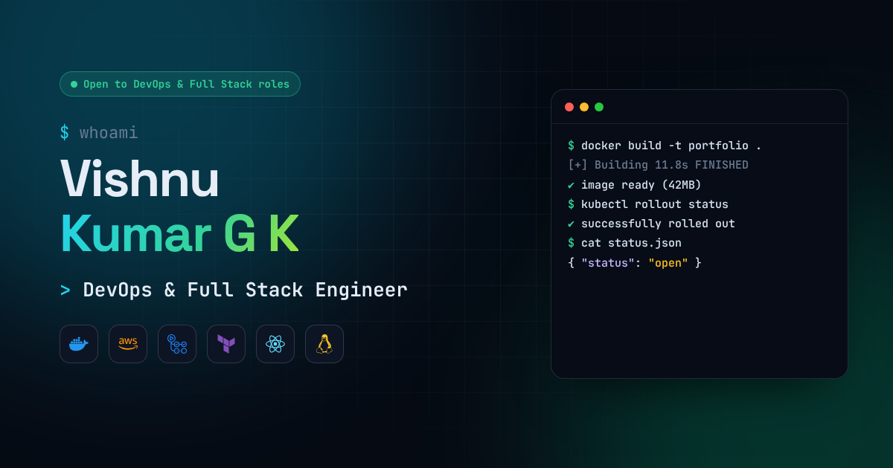
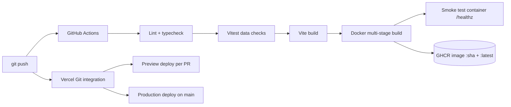

<div align="center">



# Vishnu Kumar G K · Portfolio

**My personal portfolio, built like a production app: typed, tested, containerised and shipped through CI/CD.**

[](https://github.com/vishi-vishnu/portfolio/actions/workflows/ci.yml)


[**Live site**](#deploy-to-vercel) &nbsp;·&nbsp; [Add a project](#add-a-new-project) &nbsp;·&nbsp; [Add a skill](#add-a-new-skill) &nbsp;·&nbsp; [Run locally](#run-locally) &nbsp;·&nbsp; [DevOps](#devops-setup)

</div>

---

## What's inside

| Section | What it shows |
| --- | --- |
| **Hero** | Boot-up intro, typing role titles, an **interactive terminal** (try `help`, `skills`, `projects`, `sudo hire-vishnu`), floating tech logos and a live CI/CD pipeline animation |
| **About** | Bio, a `profile.yaml` card, three focus areas (Cloud & DevOps, Web, Full Stack), a git-log style career timeline and certifications |
| **Skills** | Filterable skill cards with brand logos and animated proficiency bars, plus a scrolling logo marquee |
| **Projects** | Filterable project cards with cover images, status badges (Live, In progress, Planned, Academic), tech chips, live demo and code links, and a details modal |
| **Contact** | Copy-to-clipboard email, social links, resume download and a contact form |
| **Footer** | Call to action, links, "built with" stack and a system status card that shows the deployed commit SHA |

Also: light and dark theme, fully responsive from 360px phones to wide screens, keyboard accessible, respects "reduce motion", and no external requests at runtime (fonts and icons are bundled).

## Tech stack

**App:** React 19, TypeScript (strict), Vite, Framer Motion, react-icons, plain CSS with design tokens
**Quality:** ESLint, `tsc` type checks, Vitest data validation tests
**Delivery:** Docker multi-stage build, Nginx, GitHub Actions, GHCR, Vercel

---

## Add a new project

Everything about projects lives in **one file**: [`src/data/projects.ts`](src/data/projects.ts). No component changes needed.

1. Save a cover image in `public/projects/`, for example `public/projects/my-api.webp`.
   1600 x 1000 px (16:10) looks best. A screenshot of the app works fine.
2. Open `src/data/projects.ts`, copy any project object and paste it where you want it in the list.
3. Edit the fields:

```ts
{
  id: 'my-api',                       // unique, lowercase, no spaces
  title: 'My API',
  tagline: 'One line that sells it',
  description: 'Two or three sentences: the problem and what you built.',
  highlights: ['What you did', 'A number or result', 'A DevOps detail'],
  image: '/projects/my-api.webp',
  imageAlt: 'What the image shows',
  year: '2026',
  status: 'live',                     // 'live' | 'completed' | 'in-progress' | 'planned' | 'academic'
  categories: ['devops', 'fullstack'],// which filter tabs show it
  stack: ['Docker', 'GitHub Actions', 'AWS EC2'],
  links: {
    live: 'https://...',              // leave out if there is no demo
    github: 'https://github.com/vishi-vishnu/my-api',
  },
  featured: false,                    // true = big card at the top
},
```

4. Run `npm test`. It checks the image exists, the id is unique, links start with `https://` and every tech has a logo.

Only `live` projects show a status badge on the card. To show other badges too, add them to `VISIBLE_STATUSES` in the same file.

The filter tabs, counts, hero stats, terminal `projects` command and the details modal all update automatically.

## Add a new skill

Open [`src/data/skills.ts`](src/data/skills.ts) and add one line:

```ts
{ name: 'Ansible', category: 'devops', level: 65, note: 'Playbooks' },
```

If the logo does not show, add it to [`src/data/techIcons.ts`](src/data/techIcons.ts):

- **Full-colour logo (best):** download the "original" SVG from [devicon.dev](https://devicon.dev), save it as `src/assets/logos/ansible.svg`, import it at the top of `techIcons.ts` and add
  `Ansible: { logo: ansibleLogo, icon: SiAnsible, color: '#EE0000' },`
- **Simple icon:** search the name on [react-icons.github.io/react-icons](https://react-icons.github.io/react-icons) (brand logos start with `Si`), import it and add `Ansible: { icon: SiAnsible, color: '#EE0000' },`

Unknown names never break the site. They just show a generic code icon until you add the logo.

## Update your details

| What | File |
| --- | --- |
| Name, roles, bio, goal, hero numbers, email, links, certifications | [`src/data/profile.ts`](src/data/profile.ts) |
| Career timeline (jobs, internships, education) | [`src/data/timeline.ts`](src/data/timeline.ts) |
| Resume | replace `public/Vishnu_Kumar_GK_Resume.pdf` (keep the same name) |
| Colours and fonts | [`src/styles/tokens.css`](src/styles/tokens.css) |

---

## Run locally

```bash
npm ci
npm run dev        # http://localhost:5173
```

Other scripts:

```bash
npm run lint       # ESLint
npm run typecheck  # TypeScript
npm test           # data validation tests
npm run build      # production build into dist/
npm run preview    # serve the production build
```

### Run the production container

```bash
docker compose up --build
# open http://localhost:8080  (health check: http://localhost:8080/healthz)
```

---

## DevOps setup



- **CI** ([`.github/workflows/ci.yml`](.github/workflows/ci.yml)): every push and pull request runs lint, type checks, tests and a production build. On `main` it also builds the Docker image, pushes it to GitHub Container Registry tagged with the commit SHA and `latest`, then runs the container and checks `/healthz` and the home page.
- **Docker** ([`Dockerfile`](Dockerfile)): stage 1 builds with Node 22, stage 2 serves `dist/` with Nginx, so the final image has no Node.js and stays small. Dependency install is cached as its own layer. Includes a `HEALTHCHECK`.
- **Nginx** ([`nginx.conf`](nginx.conf)): gzip, security headers, one-year caching for hashed assets, `no-cache` for HTML so new deploys show up straight away, and a `/healthz` endpoint for container probes.
- **Vercel** ([`vercel.json`](vercel.json)): same caching and security headers. The footer shows the deployed commit SHA from `VERCEL_GIT_COMMIT_SHA`.

## Deploy to Vercel

1. Push this repo to GitHub as `vishi-vishnu/portfolio`.
2. On [vercel.com/new](https://vercel.com/new), import the repo. Vercel detects Vite automatically (build `npm run build`, output `dist`).
3. Click **Deploy**. Every push to `main` now deploys to production, and every pull request gets a preview URL.
4. Optional: to receive contact form messages by email instead of opening the visitor's mail app, create a free form at [formspree.io](https://formspree.io), then add `VITE_FORM_ENDPOINT` with the form URL in Vercel → Project → Settings → Environment Variables and redeploy.

## Project structure

```
src/
  data/            <- edit these to update content
    profile.ts       name, roles, bio, links, certifications
    projects.ts      projects (add new ones here)
    skills.ts        skills and categories
    timeline.ts      career timeline
    techIcons.ts     logo + colour for every technology
  components/
    layout/          Navbar, Footer, BootLoader, ScrollProgress
    sections/        Hero, About, Skills, Projects, Contact
    ui/              Terminal, Pipeline, ProjectCard, ProjectModal, ...
  styles/          design tokens and base styles
  test/            data validation tests
public/
  projects/        project cover images
  Vishnu_Kumar_GK_Resume.pdf
```

## License

MIT. Feel free to learn from the code; please don't reuse my personal content.
